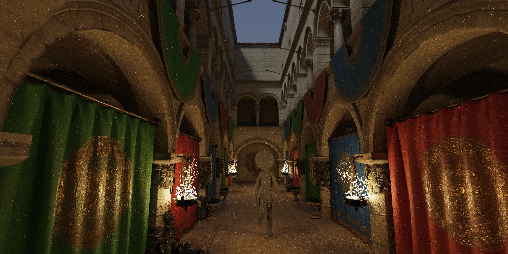

<h1 align="center">Offl.bend</h1>
<p align="center">An Offline Renderer built for the era of Software on Demand</p>



3D artists and animators have been increasingly taking on programming-adjacent tasks, creating complex and logic-intensive node graphs in applications like Blender, Houdini, and Nuke. However, this shift toward artist-friendly programming tools has very quickly been challenged by advent of vibecoding. Now, an artist or animator can describe to an AI assistant how they would like something in their scene to behave, and the assistant can create code directly to meet their needs. I believe that this workflow will supersede the node graph approach, and have created this offline renderer with it in mind.

Offl utilizes the strengths of the Bend 2 language; its automatic parallelism allows massively parallel operations that run on the GPU to exist beside simple scene logic and share the same concise codebase. This means a core path-tracing engine can exist fully within the context window of an AI assistant, without all the hoops that graphics APIs make us jump through. Because an assistant can see the precise logic that shades every pixel of every frame, it can confidently design complex and rich behaviors on a per-scene basis without all the anxiety of sifting through millions of lines of technical debt to find the part of the codebase that is pertinent to its current task.

The structure is split into three simple files. Core.bend contains the core 3D stuff like texture sampling, skinning, the node tree, and path tracing. Editor.bend contains a simple fly-around camera and communicates with an electron-powered UI overlay over TCP to handle user inputs. Scene.bend is your actual finished scene, and contains any new behavioral logic you or your AI assistant would like to implement; when run it headlessly writes a png sequence to the disk. 

In the future there will be deep scene authorship tools in editor.bend for things like environment design and animating rigged meshes, and there will be an MCP server so your assistant can help you as well. There will likely be some sort of JSON representation of a scene that can be saved to disk, however scene.bend will always be able to pipe in new behavioral logic on top of this.

The current scene.bend creates a fire particle system. While this is probably something that will be through core functionality in the future, it serves to showcase the potential of per-scene authored behavior.

This project was made in a little under a week with AI assistance, and I would love to continue working on it if funding could be secured, however in the meantime I can not promise I will update, maintain it, or actively review pull requests. Feel free to fork it; it is MIT licensed.

## Building and running

Install Bend from https://github.com/bendlang/bend (2.0.29 or newer). You also need bun for the asset importer, and Node for the PNG writer and the editor's overlay. A GPU build needs clang 19+ on Windows or CUDA 12 on Linux; `--gpu off` runs the same code on the CPU cores.

### Assets

`bun tools/import.js` turns a glTF or GLB into `assets/imported/<name>/<name>.mesh` with its textures beside it as `m<i>.<kind>.tex`. The scenes here expect `assets/imported/sponza-png/sponza-png.mesh` and `assets/imported/metal-man/metal-man.mesh`.

### Rendering a scene to disk

```
mkdir out
bend src/scene.bend -o src/scene
src/scene --gpu 12GB
```

Run it from the repo root: the asset paths and `tools/ppm2png.js` are relative to it. Frames land in `out/` as `frame<n>.png`, with the pose, trace and png milliseconds printed per frame. The `.gpu` file written beside the binary must stay beside it.

### The editor

```
bend src/editor.bend -o src/editor
cd ui && npm install && npm start
```

Electron starts `src/editor.exe` with the repo root as its working directory, connects to it on port 7777 and lays the overlay over its window. The editor waits for that connection before it opens its window. `EDITOR_EXE` overrides the binary it starts.

### Settings

Environment variables: `PT_BOUNCES` (16), `PT_STEPS` (bounce steps per editor turn, 2), `PT_FPS` (24), `PT_CAM` (`x,y,z,yaw,pitch`, fitted space and radians), `PT_PORT` (7777), `PT_PROBE=n` (n headless steps, timed; `PT_PPM=file` also dumps the view). Runtime flags on the binary: `--gpu off`, `--gpu 8GB`, `--threads n`.
